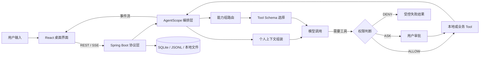

<div align="center">
  
  <h1>ButvanAgent</h1>
  <p>本地优先的桌面 Agent 工作台：对话、工具、日历、财务、资料与学习共用一个个人上下文。</p>
  <p>
    React 19 · Tauri 2 · Spring Boot 3.4 · AgentScope Java 2.0
  </p>
</div>

> 当前版本：`0.5.0`（见 [`VERSION`](VERSION) 与 [`CHANGELOG.md`](CHANGELOG.md)）。项目仍在快速迭代，适合本地体验、二次开发和架构交流，暂不宣称为完成的通用生产级 Agent 平台。

## 目录

- [项目定位](#项目定位)
- [能力概览](#能力概览)
- [架构与设计取舍](#架构与设计取舍)
- [技术栈](#技术栈)
- [快速开始](#快速开始)
- [配置与数据](#配置与数据)
- [可选能力](#可选能力)
- [项目结构](#项目结构)
- [验证与测试](#验证与测试)
- [打包与发布](#打包与发布)
- [开发约定](#开发约定)
- [当前限制](#当前限制)
- [文档入口](#文档入口)

## 项目定位

ButvanAgent 想解决的问题不是"接一个模型 API"，而是让 AI 真正参与日常开发与个人事务：理解当前项目、调用本机工具、在需要时请求确认，并在日历、财务、资料、学习这些长期数据之间建立受控联系。

实现过程中反复遇到的是同几类边界问题：

- 模型可以调用工具，但哪些工具、在什么时候、以什么 Schema 暴露？
- Agent 可以写文件、跑命令，风险动作由谁确认，刷新或重启后如何恢复？
- 上下文越多不等于效果越好，Prompt、记忆和 Tool Schema 如何分配预算？
- 桌面应用既要便于开发，又要让安装包自带后端与 JRE，用户不必装 Java。
- 日历、财务、资料和学习不是几张孤立页面，如何成为 Agent 可以安全使用的个人上下文？

项目的答案是把能力放回各自的边界：界面负责交互，服务层负责协议，Agent 层负责编排，业务数据留在本机，权限与上下文在真正调用模型前收口。

仓库同时包含规划中的原生 iOS App（`RecordAgent APP/IOS APP/`）及其独立业务后端；桌面端与 iOS 端的接口契约各自独立演进，不共用桌面 sidecar 代码。

## 能力概览

### 对话与模型

- 支持 Gemini、OpenAI、DashScope、DeepSeek、Anthropic，以及可自定义地址与协议的自定义 API。
- SSE 流式展示回答、Thinking、工具调用、子 Agent 进度与最终状态。
- 普通会话与项目会话分开管理，项目会话可关联本地工作区。
- 支持中止运行并保留 partial assistant、工具状态与 Token 用量；显式取消与传输断开分别处理。
- 会话标题生成、权限模式切换、Token 明细与上下文占用查看。

### 工具与安全

- 工具按工作区、记忆、规划、委派、Skill、联网、日历、财务、资料、学习等能力组管理，默认只常驻轻量元工具，其余 Schema 按本轮任务延迟暴露。
- 工具权限支持 `ALLOW`、`ASK`、`DENY` 分级；高风险调用形成一张批量审批卡片，可逐项或批量决定，审批绑定原始 `runId`，避免恢复时重放。
- 自定义规则从 `~/.butvan-agent/permissions.yaml` 读取；文件与命令能力仍以操作系统权限为上限。
- Jev 是可选的能力组路由器，只预测本轮可能需要的工具组，不保存或执行工具，也不参与权限判断。

### 个人数据模块

| 模块 | 当前能力 | Agent 接入方式 |
| --- | --- | --- |
| 日历 | 待办、日程、花销、手记、循环待办与便签 | 受控业务 Tool + 今日上下文 |
| 财务 | 账户、收支、转账、流水编辑、余额调整与趋势统计 | 最小化汇总，敏感分析逐次确认 |
| 资料 | 富文本编辑、分类 Tab、标签、附件、回收站、备份恢复 | 稳定文件 ID 引用 + 字符预算 |
| 学习 | 开始、结束、补录、分类、统计与年度热力图 | 业务 Tool + SSE 跨窗口同步 |
| 任务与自动化 | 自定义提醒、日报/周报/月报、久坐提醒、邮件与桌面通知 | 后端调度为权威事实，桌面端承担本机提醒 |
| 个人上下文 | 画像、记忆召回、维护提案与显式确认 | Model Call 前按预算临时注入 |
| Token 用量 | 轮次、模型调用、输入归因与年度活动统计 | 原始记录 + SQLite 读模型 |

聊天输入框还提供一层本地 Slash Command 路由：`/status`、`/today`、`/spending` 等确定性查询不必调用模型；`/daily-review`、`/finance-review` 等分析命令先确认数据范围，再把受控上下文交给 Agent。

## 架构与设计取舍



三个刻意保留的设计决定：

1. **前端不拥有业务数据。** API、SSE 与错误映射集中在 `services`，页面只做状态编排。
2. **Agent 不直接持有持久化。** Tool 通过业务 Adapter 访问日历、财务、资料、学习服务，稳定 ID 比磁盘路径更重要。
3. **上下文不写入长期状态。** 画像与记忆只在 Model Call 前按预算临时注入，避免污染 transcript，也避免每轮重带整个工作区。

## 技术栈

| 层次 | 主要技术 | 作用 |
| --- | --- | --- |
| 桌面壳 | Tauri 2、Rust | 窗口与系统能力、sidecar 生命周期、动态端口注入、桌面偏好 |
| 前端 | React 19、TypeScript、Vite 8、CSS Modules | 页面、领域组件、SSE 状态与本地交互 |
| 编辑与展示 | Tiptap 3、React Markdown、Shiki、Mermaid | 资料编辑、Markdown 渲染、代码高亮与图表 |
| 后端 | Java 21、Spring Boot 3.4 | REST/SSE、业务服务、文件资产与本地持久化 |
| Agent | AgentScope Java 2.0 | 模型调用、Middleware、Tool、状态与多 Agent 编排 |
| 数据 | SQLite、JSONL、本地文件 | 结构化业务数据、原始用量记录、会话与文件对象 |
| 构建 | Maven、pnpm、Cargo、jlink | 前后端构建、最小 JRE 与跨平台安装包 |

## 快速开始

### 环境要求

从源码开发或打包需要：

- JDK 21（必须包含 `jlink` 与 `jdeps`）
- Maven 3.9+
- Node.js 22+
- pnpm 10+
- Rust stable 与 Cargo
- 当前系统的 Tauri 原生构建依赖（见[打包与发布](#打包与发布)）

可从官方渠道安装：[Temurin JDK 21](https://adoptium.net/temurin/releases/?version=21)、[Maven](https://maven.apache.org/install.html)、[Node.js](https://nodejs.org/en/download)、[pnpm](https://pnpm.io/installation)、[Rust](https://www.rust-lang.org/tools/install)。

正式安装包已内嵌 Spring Boot sidecar 与最小 JRE，普通使用者无需安装 Java。

### 1. 获取代码与依赖

```bash
git clone https://github.com/Kavanio/RecordAgent.git
cd RecordAgent
pnpm --dir agent-frontend install --frozen-lockfile
```

### 2. 启动后端

```bash
cd agent-backend
mvn -pl server-network -am spring-boot:run
```

开发模式默认监听 `http://localhost:8081`，可直接检查健康状态：

```bash
curl http://localhost:8081/api/health
```

也可以在 IDE 中运行 `ButVanAgentApplication`。

### 3. 启动桌面端

另开终端：

```bash
cd agent-frontend
pnpm tauri dev
```

`tauri dev` 不会打包或拉起后端，这是有意保留的开发边界：前端热更新与后端调试互不干扰，日志也更容易观察。

首次进入应用时，初始化页会引导填写模型供应商、模型名称与 API Key；配置只写入当前用户目录，不进入仓库。

### 只开发浏览器界面

后端启动后也可以只运行 Vite：

```bash
pnpm --dir agent-frontend dev
```

浏览器模式同样连接 `http://localhost:8081`，但没有 Tauri 原生窗口与系统能力。

## 配置与数据

默认用户数据根目录是 `~/.butvan-agent/`：

```text
~/.butvan-agent/
├── config.json              # 模型、联网搜索、Jev、邮件、飞书等配置
├── permissions.yaml         # 自定义工具权限规则
├── desktop/                 # 桌面长期偏好（见下方说明）
├── data/
│   ├── butvan.db            # 日历、财务、资料、学习等结构化数据
│   └── files/objects/       # 文件资产二进制对象
├── daily-context/           # 天气、节假日等外部数据缓存
├── projects/                # 导入项目与会话工作区
├── transcripts/             # 会话与轮次原始记录
├── agentscope/              # AgentScope 运行态工作区
├── sessions/                # AgentScope 会话状态
├── runs/                    # 未结束运行的临时恢复信息
├── usage/                   # 非聊天模型调用的用量账本
└── profile/                 # 个人画像、设置、提案与确认历史
```

几个需要特别说明的口径：

- **凭据只存本地。** API Key 与 SMTP、飞书等凭据只保存在 `config.json`，不写入源码或 `application.yml`。
- **桌面偏好独立持久化。** 顶栏模块开关、侧边栏宽度、学习小窗位置、Slash Command 定制、后台运行、提醒音色与上传音频、远程后端地址统一放在 `desktop/`（`preferences.json`、`task-desktop.json`、`task-reminder/`、`backend-connection.json`）。该目录与业务数据同寿命，删除应用、重装或用第三方卸载工具清理 `~/Library` 都不会丢失；WebView localStorage 仅作同步缓存。旧版本数据在启动时自动迁移，新值优先。
- **用量口径分离。** 供应商返回的 Usage 是实际总量；System、History、Tool Schema、RAG、Memory 等分类是带计数器版本的本地估算，两者不互相补齐。
- **读模型可重建。** SQLite 中的 Token 表是可重建的统计读模型，原始事实以 `transcripts/` 与 `usage/` 的 JSONL 为准。
- **文件资产有归属。** 通用文件由 `FileAssetService` 管理所有权、业务绑定与生命周期，业务表只保存稳定文件 ID。
- **画像需显式确认。** 画像维护默认关闭；即使开启也只生成带来源与置信度的提案，必须由用户确认后才写入。

备份建议在应用退出后整体复制 `~/.butvan-agent/`；资料模块另提供 ZIP 导入导出。

## 可选能力

### 自定义模型 API

在「设置 → 模型配置 → 添加模型」选择「自定义 API」，填写基础地址、Model ID 与密钥，并选择 `OpenAI Chat Completions` 或 `Anthropic Messages` 协议。每个自定义连接使用独立 Provider ID，可并存多套网关与密钥；「测试连接」由后端发起真实请求。地址只接受不含账号、查询参数或片段的 HTTP(S)。详见 [`docs/自定义模型API配置.md`](docs/自定义模型API配置.md)。

### Tavily 联网搜索

默认关闭，需在 `~/.butvan-agent/config.json` 增加 `webSearch` 节点后启用；密钥只留在本地配置。

### Jev Tool Schema 路由

默认关闭，可在聊天输入区切换。它只参与能力组预测，最终 Schema 选择、权限判断与工具执行仍在本地完成。

### 飞书渠道

`server-feishu` 通过长连接接收本人私聊，复用 `server-agents`：受理后立即发送普通文本回执，长任务默认每 60 秒提醒，完成后发送完整文本（长文分段），不再使用流式卡片。配置须包含 `feishu.enabled=true`、`appId`、`appSecret` 以及唯一的本人 `allowedSenderIds`；旧配置缺少白名单时安全禁用，群聊不开放。

任务受理、会话绑定和回复投递保存在后端数据目录；支持排队、停止、重启核对和人工补发，发送失败不会重新执行工具。配置迁移、命令、限额与故障处理见 [`agent-backend/server-feishu/README.md`](agent-backend/server-feishu/README.md)。

### 任务、邮件与桌面提醒

任务配置、执行与通知记录由后端 `automation` 模块持有；远程模式下由服务器持续调度，桌面端负责本机原生状态采集、系统通知、固定尺寸提醒窗口与休息遮罩。程序完全退出后本机能力暂停。告警邮件只投递到已验证的绑定邮箱，未配置 SMTP 时相关接口明确返回不可用。

## 项目结构

```text
ButvanAgent/
├── agent-frontend/              # React、Vite 与 Tauri 桌面端
│   ├── src/components/          # 公共组件与 chat/calendar/finance/record/study/task 等领域组件
│   ├── src/features/            # Slash Command、日历、记录、自动化等前端领域能力
│   ├── src/services/            # REST、SSE、存储与桌面适配
│   ├── src/types/               # 前端领域类型与 DTO
│   └── src-tauri/               # Rust 壳层、sidecar 管理、桌面偏好与系统能力
├── agent-backend/
│   ├── server-agents/           # AgentScope、模型、Tool、上下文、权限与编排
│   ├── server-network/          # Controller、业务服务、SQLite、文件资产与自动任务
│   ├── server-feishu/           # 飞书渠道适配
│   └── scripts/                 # 后端 sidecar 组装
├── RecordAgent APP/IOS APP/     # 原生 SwiftUI App 与独立多用户业务后端（规划/进行中）
├── scripts/                     # 桌面打包、版本同步与 sidecar 验证
├── AGENTS.md                    # 全仓工程契约（DOX）
├── CONTEXT.md                   # 领域术语与数据口径
├── DESIGN.md                    # 视觉系统
├── PROJECT.md                   # 项目规格
├── PRODUCT.md                   # 产品定位
└── VERSION                      # 桌面端唯一版本源
```

后端依赖方向保持单向：

```text
server-network ──> server-agents
       │
       └────────> server-feishu ──> server-agents
```

`server-agents` 不反向依赖网络层业务实现；需要把日历、财务等能力交给 Agent 时，由 `server-network` 提供 Tool Adapter。

## 验证与测试

提交前至少运行与改动范围对应的检查。完整基线：

```bash
# 后端测试
mvn -f agent-backend/pom.xml test

# 前端静态检查与生产构建
pnpm --dir agent-frontend lint
pnpm --dir agent-frontend build

# 前端领域测试（全量，自动发现 src 下所有 *.test.mjs）
pnpm --dir agent-frontend test

# 需要只跑单个文件时显式指定
pnpm --dir agent-frontend test src/components/chat/ChatWorkspace.test.mjs

# Rust 壳层检查
cargo check --manifest-path agent-frontend/src-tauri/Cargo.toml

# 版本一致性
node scripts/sync-version.mjs --check
```

GitHub Actions 不运行测试：桌面 Release 工作流只依据版本 tag 创建 Release；后端镜像工作流在 `develop` 后端相关变更时构建并推送阿里云 ACR。测试与集成验证在本地完成。

## 打包与发布

### 平台前置依赖

在通用工具之外，各系统还需：

- **macOS**：`xcode-select --install`。按当前 Mac 架构构建，Intel 与 Apple Silicon 分别在对应设备上打包并使用同架构 JDK。[Tauri macOS 前置条件](https://v2.tauri.app/start/prerequisites/#macos)
- **Windows**：Visual Studio C++ Build Tools（勾选"使用 C++ 的桌面开发"）、WebView2 Runtime、[Git for Windows](https://git-scm.com/download/win)。请在 Windows 原生 PowerShell 或 x64 Native Tools 终端中执行，不要在 WSL 中打包。若 MSI 构建报 `light.exe` 或 VBScript 错误，请启用系统 VBScript 可选功能。[Tauri Windows 前置条件](https://v2.tauri.app/start/prerequisites/#windows)
- **Linux（Debian/Ubuntu）**：

  ```bash
  sudo apt update
  sudo apt install -y libwebkit2gtk-4.1-dev build-essential curl wget file libxdo-dev libssl-dev libayatana-appindicator3-dev librsvg2-dev patchelf
  ```

  建议在 Ubuntu 22.04 或 Debian 12 上构建，以获得更好的 glibc 兼容性。[Tauri Linux 前置条件](https://v2.tauri.app/start/prerequisites/#linux)

启用 pnpm 10（仓库根目录）：

```bash
corepack enable
corepack prepare pnpm@10 --activate
node scripts/sync-version.mjs --check
```

### 构建安装包

macOS / Linux：

```bash
./scripts/build-app.sh
```

Windows（原生开发终端）：

```powershell
bash scripts/build-app.sh
```

脚本内部执行 `pnpm tauri build`，并由 `beforeBuildCommand` 调用 `agent-backend/scripts/package-sidecar.sh` 生成后端 sidecar、最小 JRE 与平台启动器。产物位于 `agent-frontend/src-tauri/target/release/bundle/`：

- macOS：`.dmg`、`.app`
- Windows：`.msi`、`.exe`
- Linux：交互终端选择 `.deb` / `.AppImage`，非交互默认两者；`.deb` 将应用与 sidecar 安装到 `/opt/ButvanAgent`，`/usr/bin` 仅保留启动符号链接

常用参数：

```bash
./scripts/build-app.sh --debug                  # debug 构建，产物在 target/debug/bundle/
./scripts/build-app.sh --bundles deb            # 只构建指定格式
./scripts/build-app.sh --install                # macOS：构建并替换 /Applications 中的应用
./scripts/build-app.sh --open                   # macOS：构建、安装并启动
```

更新时建议用 `--install` / `--open` 原地替换，不要先删应用再安装；也不要用第三方卸载器清理 `~/Library`，否则会丢掉系统级应用数据（业务数据与桌面偏好已在 `~/.butvan-agent/`，不受影响）。

打包流程按本机系统与 CPU 架构构建，不提供跨操作系统或跨架构交叉编译。Linux 首次构建或 fat jar / JDK 变化时重新生成最小 JRE，未变化时复用；Windows 安装包未签名时 SmartScreen 提示、macOS 未配置 Developer ID 时的 Gatekeeper 提示均属预期。

### 运行模式

- 打包模式下由 Tauri `backend.rs` 启动、健康检查与退出清理 sidecar，端口动态分配。
- 远程后端可用时不启动本地 sidecar；远程不可用时自动降级到本机后端，保证只有一个调度器。
- 前端 API 地址统一由 `services/api.ts` 获取，组件中禁止硬编码地址或端口。
- 远程部署必须设置 `BUTVAN_API_REQUIRE_TOKEN=true`、提供至少 32 字符的 `BUTVAN_API_TOKEN`、限定 CORS 来源并配置网络访问控制；当前业务仍是单用户本地数据模型，不得暴露到不可信网络。

### 后端镜像自动发布

`develop` 的桌面后端源码、Maven 配置、Docker 文件或镜像工作流变化时，GitHub Actions 构建 Java 21 JAR 与 `linux/amd64` 镜像，推送到阿里云私有仓库 `butvan/record-agent-backend`。仅前端、iOS 或文档变化不触发；也可手动触发。需配置 Secrets `ACR_USERNAME`、`ACR_PASSWORD`。

Windows 服务器保留原 `compose.yaml`、`.env` 与 `user-data`，叠加 `agent-backend/compose.acr.yaml` 覆盖文件，登录 ACR 后拉取重建容器即可。更新、回滚与备份步骤见 [`agent-backend/DOCKER.md`](agent-backend/DOCKER.md)。

### 桌面端版本发布

1. 按分支规范完成开发分支 → `main` → `develop` 的本地合并与验证。
2. 在发布准备分支更新根目录 `VERSION`，同步并检查版本：

   ```bash
   node scripts/sync-version.mjs
   node scripts/sync-version.mjs --check
   ```

3. 将 `CHANGELOG.md` 的 `## [未发布]` 内容整理为严格匹配 tag 的章节，例如 `## v0.5.0` 或 `## v0.5.1-beta.1`。
4. 提交版本与变更日志，按规范合入 `main`、`develop`，完成本地验证后推送 `develop`。
5. 在已推送到 `develop` 的提交上创建并推送带注释 tag：

   ```bash
   git tag -a vX.Y.Z -m "Release vX.Y.Z"
   git push origin vX.Y.Z
   ```

工作流校验 tag 格式、`VERSION`、前端/Tauri 版本同步、tag 是否已合入 `develop`，以及 CHANGELOG 中对应章节非空后，直接创建 GitHub Release（预发布后缀则创建 Pre-release），正文取自该章节；不构建、不上传安装包。校验失败时请递增版本并创建新 tag，不要移动或复用已发布的 tag。

## 开发约定

文档被视为工程边界，而不是完成代码后的补充说明。

- 修改文件前，从仓库根目录开始逐级阅读目标路径上的 `AGENTS.md`。
- 分支流向：`ios-app/*` 或 `desktop/*` → `main` → `develop`；功能分支从 `main` 创建，`main` 只做本地集成验证。
- Controller 只负责协议适配；业务逻辑进入 Service 或明确的领域组件。
- 前端 API 必须经过 `services`；可复用交互必须沉淀为统一组件并同步 `UI COMPONENTS.md`。
- 新增 Tool 时同时确认权限、能力分组、Schema 暴露方式、幂等性与测试。
- 涉及职责、接口、持久化、权限或用户体验的变更，完成后必须执行 DOX 复核。

完整规则以 [`AGENTS.md`](AGENTS.md) 为准。

## 当前限制

- 安装包签名仍需完善：未配置签名时，macOS Gatekeeper 与 Windows SmartScreen 警告属于预期。
- 资料引用目前以文本与轻量元数据为主，附件 OCR、PDF 分段检索尚未进入上下文。
- Agent 真正可恢复的暂停仍需明确 checkpoint、待恢复动作与工具幂等语义，当前不会用线程挂起模拟恢复。
- 邮箱只是本机通知地址；跨设备账户、同步与云端身份不在当前闭环内。
- 模型、外部搜索与 Jev 的可用性取决于对应供应商服务与用户自己的凭据。
- iOS App 与其独立后端仍在早期阶段，尚未与桌面端共享业务数据。

后续迭代沿用同一条原则：先把数据口径、权限边界与失败路径讲清楚，再扩大能力范围。

## 文档入口

- [`AGENTS.md`](AGENTS.md)：工程契约、目录职责、分支与交付规范。
- [`PROJECT.md`](PROJECT.md)：项目规格与能力基线。
- [`PRODUCT.md`](PRODUCT.md)：产品定位与目标用户。
- [`CONTEXT.md`](CONTEXT.md)：日记录、学习时段、模型调用、Token 用量等统一口径。
- [`DESIGN.md`](DESIGN.md)：零阴影、小圆角、细描边的视觉规范。
- [`UI COMPONENTS.md`](UI COMPONENTS.md)：全量公共 UI 组件契约清单。
- [`CHANGELOG.md`](CHANGELOG.md)：版本变更记录。
- [`docs/桌面端本地打包与安装.md`](docs/桌面端本地打包与安装.md)：本机打包与安装细节。
- [`agent-backend/DOCKER.md`](agent-backend/DOCKER.md)：后端容器部署与更新。

## License

当前仓库尚未声明开源许可证。在许可证补充之前，请不要默认代码可以被复制、修改或再分发；如需使用，请先联系项目维护者确认授权。
